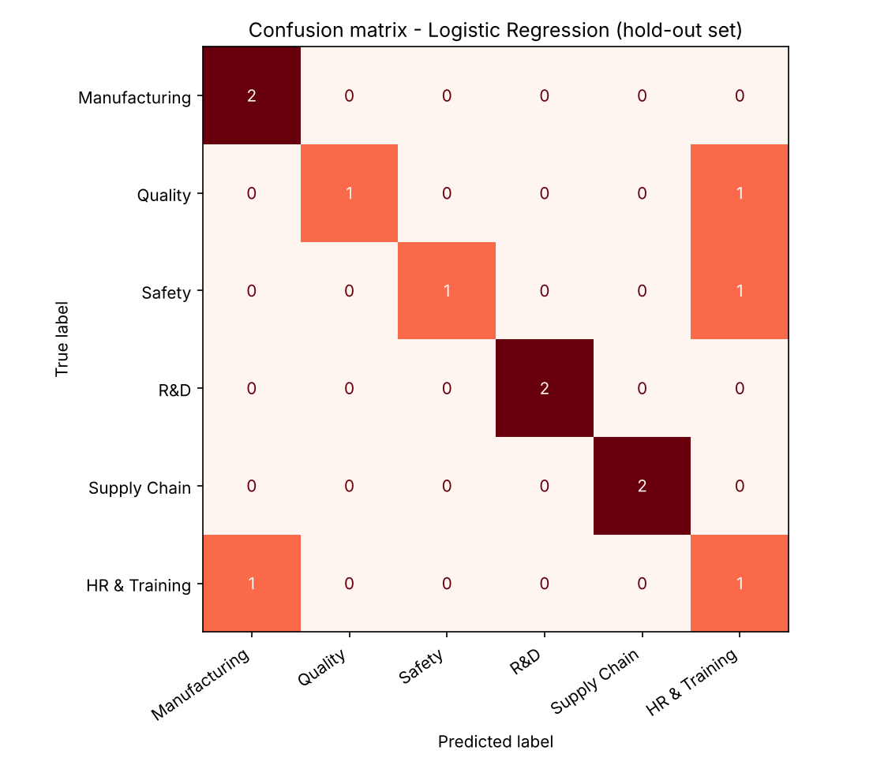
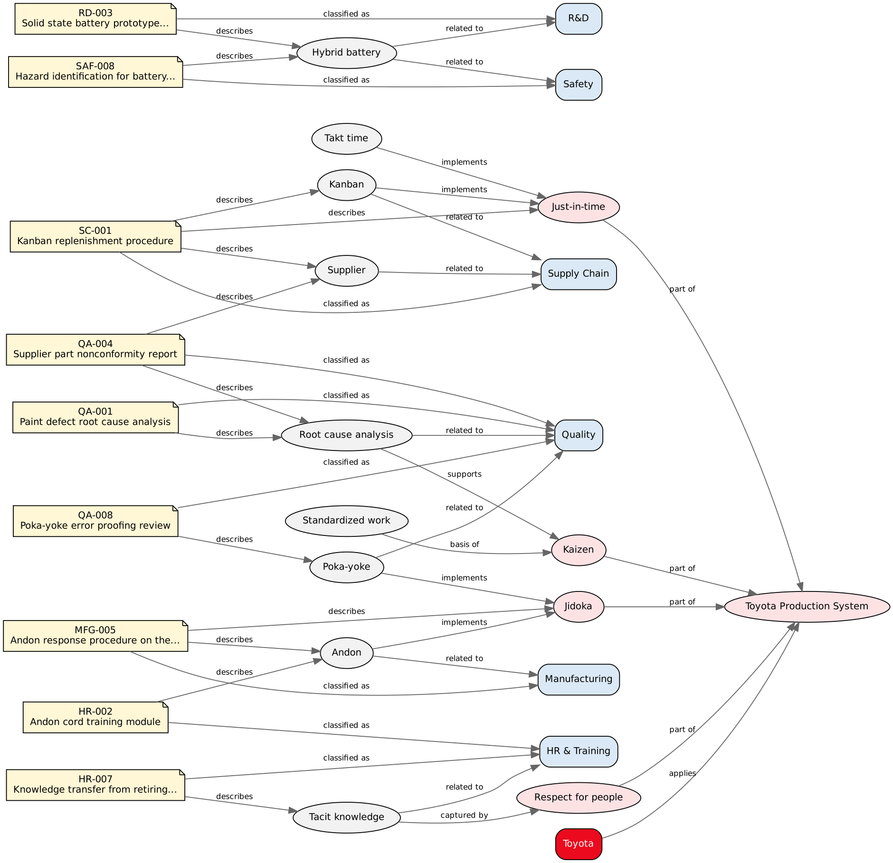

# Toyota Knowledge Management System — Prototype

Prototype for the course **Sistemas y tecnologías de administración del conocimiento** (Tecmilenio).
Authors: Héctor Emiliano Leal Prieto, Héctor Kuri Aguirre.

A small knowledge management prototype built around Toyota. It classifies documents automatically,
answers natural-language searches, and represents organizational knowledge as an ontology.

## What it does

| Component | File | Technique |
| --- | --- | --- |
| Document corpus | `data/toyota_documents.json` | 48 sample Toyota documents, 8 per category |
| Automated classification | `classifier.py` | TF-IDF + Multinomial Naive Bayes / Logistic Regression |
| Semantic search | `semantic_search.py` | TF-IDF + cosine similarity |
| Ontology / conceptual graph | `ontology.py` | Subject–predicate–object triples + Graphviz |

Categories: Manufacturing, Quality, Safety, R&D, Supply Chain, HR & Training.

## Results (last run)

- Logistic Regression: **75%** hold-out accuracy, **70.8%** 4-fold cross-validation
- 6 of 6 unseen documents classified correctly
- 5 of 6 search queries returned a relevant first result
- 142 ontology triples, 25 document–concept links found automatically from text




## Setup

```bash
pip install -r requirements.txt
```

Graphviz is optional; it is only used to draw `output/ontology_graph.png`.

## Run

```bash
python classifier.py                               # train, evaluate, classify new documents
python semantic_search.py                          # demo queries
python semantic_search.py "how do I stop the line" # one query
python semantic_search.py -i                       # interactive mode
python ontology.py                                 # build triples and graph
```

## Output folder

`output/` holds the results of the last run: terminal logs, screenshots, the confusion matrix,
the ontology triples (CSV), the conceptual graph and the trained model (`toyota_classifier.joblib`).
